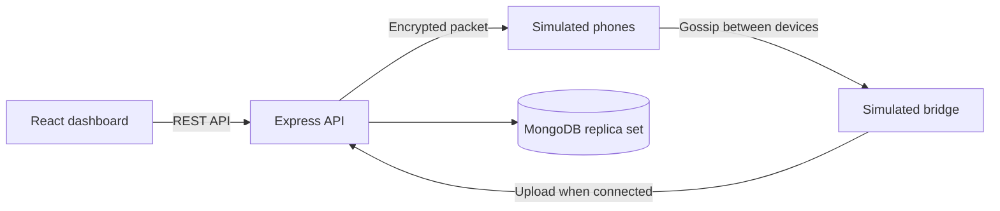

<div align="center">

# UPI Offline Mesh

### A simulation of payment instructions moving across an offline device mesh

React dashboard · Express API · MongoDB · Hybrid encryption

<br />


</div>

> [!WARNING]
> **Educational demo only.** This is not connected to UPI, a bank, or NPCI. Do not use it for real payments or deploy it as a public payment service.

## What is this?

UPI Offline Mesh is a full-stack demo that shows how an encrypted payment instruction could travel between simulated phones while offline, then reach a simulated bridge device and settle when connectivity is available.

It is designed to explore the flow—not to provide real offline banking, Bluetooth/Wi-Fi Direct networking, or protection against offline double-spending.

## Features

- **Offline packet flow:** simulate payment packets moving between virtual devices.
- **Hybrid encryption:** AES-256-GCM encrypts the instruction; RSA-OAEP encrypts the AES key.
- **Bridge settlement:** upload packets from an internet-connected simulated bridge.
- **Replay and duplicate checks:** idempotency claims and duplicate transaction protection.
- **Payment dashboard:** inspect mesh activity, demo accounts, and the transaction ledger.
- **Docker-ready deployment:** serve the production React build and Express API from one service.

## How it works



The mesh exists in server memory and resets when the API restarts. Account balances, settled transactions, and idempotency claims are stored in MongoDB.

## Project structure

| Folder / file | Purpose |
| --- | --- |
| [`Frontend/`](./Frontend) | React dashboard and Vite development server |
| [`Backend/`](./Backend) | Express API, MongoDB models, encryption, and mesh simulator |
| [`scripts/`](./scripts) | Starts the frontend and backend together for development |
| [`Dockerfile`](./Dockerfile) | Builds the frontend and packages it with the API |
| [`docker-compose.yml`](./docker-compose.yml) | Local MongoDB replica-set service |
| [`.env.example`](./.env.example) | Template for local environment settings |

## Run locally

### Requirements

- Node.js 20 or later
- Docker Desktop for the included local MongoDB, or a MongoDB replica-set connection string

### Start the app

```powershell
npm install
Copy-Item .env.example .env
docker compose up -d
npm run dev
```

Open <http://localhost:5173>. The React app runs on port `5173`; Vite proxies `/api` requests to Express on port `8080`.

To use MongoDB Atlas instead, put its replica-set URI in `.env` as `MONGODB_URI` and skip `docker compose up -d`. Keep credentials private and never commit `.env`.

## Deploy frontend to Vercel and backend to Render

The frontend is deployed separately from the API. Deploy the backend first so you can use its public URL when configuring Vercel.

### 1. Deploy the backend to Render

1. In Render, create a **Web Service** and connect this GitHub repository.
2. Set **Root Directory** to `Backend`.
3. Select the **Node** runtime. Use `npm install` as the build command and `npm start` as the start command.
4. Add these environment variables:

   | Variable | Value |
   | --- | --- |
   | `MONGODB_URI` | MongoDB Atlas replica-set connection URI |
   | `WEB_ORIGIN` | Your Vercel production URL, e.g. `https://your-project.vercel.app` |

   Render supplies `PORT` automatically. If you add a Vercel custom domain, update `WEB_ORIGIN` to that exact origin and redeploy the backend.

5. Configure the Atlas database user and network access. After Render finishes deploying, verify `https://YOUR-API.onrender.com/api/health` returns `{"status":"ok"}`.

### 2. Deploy the frontend to Vercel

1. In Vercel, import the same GitHub repository as a new project.
2. Set **Root Directory** to `Frontend` and confirm it as the project root.
3. Use the Vite defaults: build command `npm run build`, output directory `dist`, install command `npm install`.
4. Add this environment variable in Vercel's project settings:

   | Variable | Value |
   | --- | --- |
   | `VITE_API_URL` | Your Render API origin, e.g. `https://YOUR-API.onrender.com` |

5. Deploy (or redeploy after adding the variable). Open the Vercel URL and check that the dashboard loads data.

`VITE_API_URL` is included in the public frontend bundle, so it must contain only the API URL—not secrets. Do not add `MONGODB_URI` to Vercel. Put database credentials only in Render's environment settings, never in GitHub or a committed `.env` file.

### Optional: deploy the combined Docker app

The root [`Dockerfile`](./Dockerfile) is for running the frontend and backend together on a Docker host. It is not needed for the split Vercel + Render setup above.

## Verify

```powershell
npm test
npm run build
```

The tests cover amount conversion, encryption and ciphertext tampering, and mesh gossip. Full database settlement requires a reachable MongoDB replica set.

## Demo limitations

- This is **not an actual UPI integration** and does not authenticate with a bank or NPCI.
- PINs are hashed for the demo; they are not verified against a real credential.
- The mesh is an in-memory simulation, not Bluetooth or Wi-Fi Direct.
- Offline payment instructions are not guaranteed funds; insufficient balance is rejected at settlement.
- Offline double-spending is not prevented.
- The RSA key pair is generated when the API starts, so a restart invalidates packets encrypted with the previous key.
- Real payment use would require a completely different, professionally reviewed security and regulatory design.
